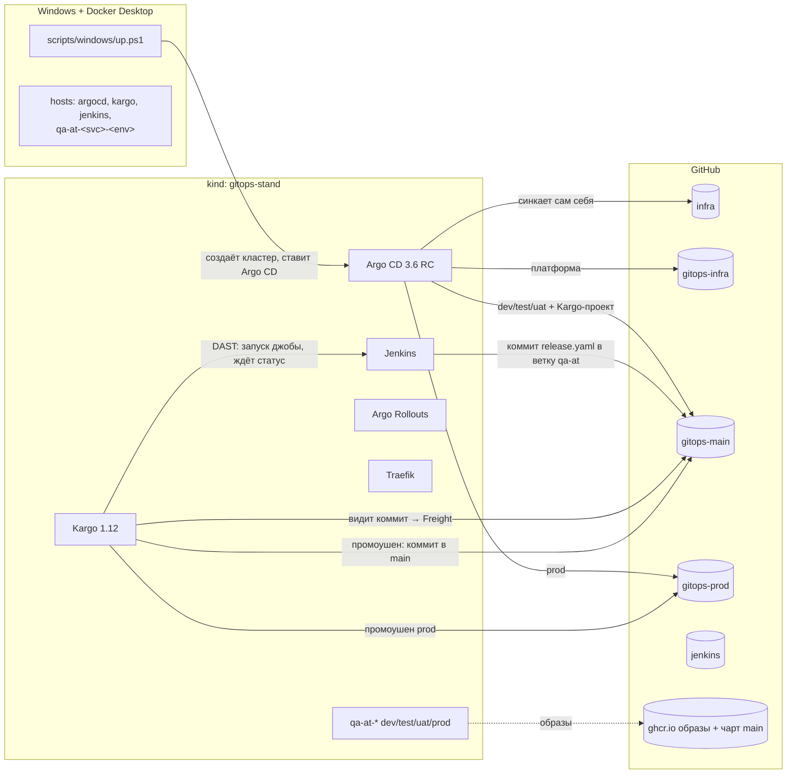
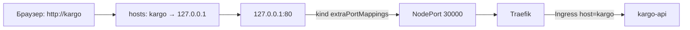
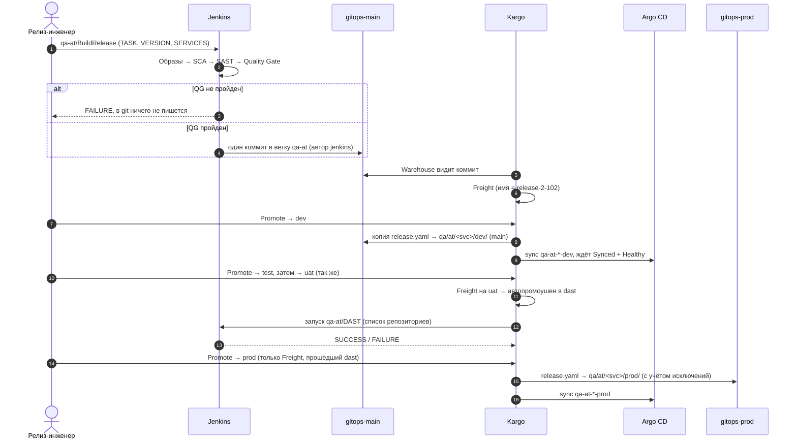
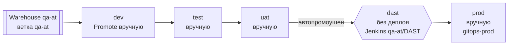
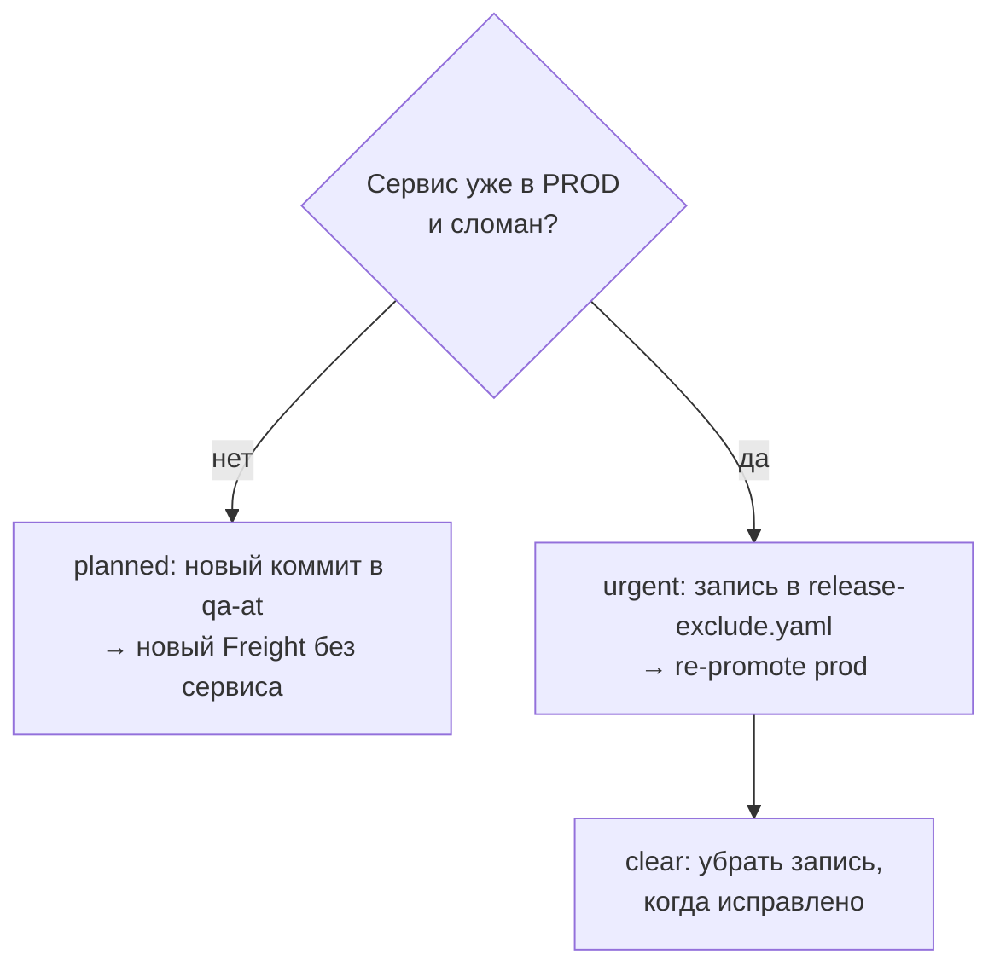

# GitOps-стенд: как всё устроено

Сводка конфигурации стенда: из чего он состоит, что лежит в каждом репозитории, как работают Argo CD, Kargo и Jenkins и почему настроено именно так.
Схемы — Mermaid (GitHub рисует их сам).

---

## 1. Общая картина

Стенд эмулирует корпоративный релизный процесс ФП `qa/at` (три сервиса: `mgmt`, `core`, `api`) на локальном kind-кластере под Windows.



Главные принципы:

- **Всё из git.** Скрипт ставит только Argo CD; остальное Argo CD разворачивает сам через ApplicationSet'ы.
- **ApplicationSet, а не app-of-apps.** Новая папка в git = новое приложение, руками Application не создаются.
- **Без kustomize в ФП.** Каждое окружение — Helm umbrella-чарт: `Chart.yaml` + values окружения + `release.yaml` с версией.
- **Jenkins пишет только в git и никогда не ходит в Kargo.** Kargo сам видит коммит и сам вызывает Jenkins для DAST.
- **Freight руками не создаётся.** Freight = коммит Jenkins в ветку ФП.

---

## 2. Репозитории

| Репозиторий | Кто пишет | Содержимое |
|---|---|---|
| [scripts](https://github.com/PonamaryovMV/scripts) | люди | `windows/up.ps1`, `down.ps1`, `hosts.ps1`, `config/kind-config.yaml`, этот документ |
| [infra](https://github.com/PonamaryovMV/infra) | люди | Argo CD (kustomize поверх install.yaml v3.6.0-rc4), AppProject'ы, репозитории, ApplicationSet'ы |
| [gitops-infra](https://github.com/PonamaryovMV/gitops-infra) | люди | Платформа: `components/<имя>/{component.yaml, values.yaml}`; общий Helm-чарт `charts/main` |
| [gitops-main](https://github.com/PonamaryovMV/gitops-main) | люди, **Jenkins** (ветка `qa-at`), **Kargo** (`main`) | ФП `qa/at` dev/test/uat; Kargo-проект `kargo/qa-at/`; демо-приложение |
| [gitops-prod](https://github.com/PonamaryovMV/gitops-prod) | люди, **Jenkins** (исключения), **Kargo** | ФП `qa/at` prod; `qa/at/release-exclude.yaml` |
| [jenkins](https://github.com/PonamaryovMV/jenkins) | люди | Jenkinsfile'ы, `scripts/release_tool.py`, `scripts/policy.json`, образ агента |

GitHub Actions:

| Репозиторий | Workflow | Что делает |
|---|---|---|
| gitops-main | `seed-images` | один раз собирает 18 демо-образов `qa-at-<svc>-<api\|worker>:release-{1-101,2-102,3-103}` |
| gitops-main, gitops-prod | `validate` | рендерит каждую папку окружения через Helm так же, как Argo CD |
| gitops-infra | `publish-chart` | lint + публикация чарта `main` в `oci://ghcr.io/ponamaryovmv/charts` |
| jenkins | `agent-image` | образ агента `ghcr.io/ponamaryovmv/jenkins-agent-python:1` (python 3.14-slim + git + pyyaml) |

---

## 3. Запуск: что делает `up.ps1`

```powershell
cd C:\Users\ponam\stend
git -C scripts pull
# scripts\.env:  GITHUB_TOKEN=ghp_...   (classic PAT, scope repo)
powershell -ExecutionPolicy Bypass -File .\scripts\windows\up.ps1
```

| Шаг | Функция | Что происходит |
|---|---|---|
| 1 | `Import-DotEnv` | читает `scripts\.env` (GITHUB_TOKEN) |
| 2 | `Test-Docker`, `Install-Tools` | проверяет Docker; качает kind v0.33.0 и kubectl v1.37.2 в `..\bin` |
| 3 | `New-Cluster` | создаёт kind `gitops-stand`; пересоздаёт, если нода остановлена или нет проброса порта 80 |
| 4 | `Update-Kubeconfig` | перезаписывает `%USERPROFILE%\.kube\gitops-stand.yaml` для Lens (удаляет старый контекст) |
| 5 | `Start-ImagePrefetch` | в фоне качает в ноду образы агентов Jenkins, чтобы первая джоба стартовала быстро |
| 6 | `Set-Secrets` | неймспейсы и секреты (см. раздел 10) |
| 7 | `Update-Hosts` | через UAC вызывает `hosts.ps1`, добавляет имена в hosts |
| 8 | `Install-ArgoCD` | скачивает infra, `kubectl apply --server-side -k`, ждёт argocd-server, ставит пароль admin/123 |
| 9 | `Wait-Platform` | ждёт CRD Rollouts и Kargo; при необходимости перезапускает Kargo |
| 10 | `Show-Status` | печатает адреса |

Доступы (везде `admin` / `123`):

| Что | Адрес |
|---|---|
| Argo CD | http://argocd |
| Kargo | http://kargo |
| Jenkins | http://jenkins |
| Сервисы ФП | http://qa-at-&lt;mgmt\|core\|api&gt;-&lt;dev\|test\|uat\|prod&gt; |
| Lens | `%USERPROFILE%\.kube\gitops-stand.yaml`, API `127.0.0.1:6550` |

Остановка: `down.ps1` (удалить кластер), `down.ps1 -CleanupHosts` (+ убрать имена из hosts).

---

## 4. Кластер и вход



- `config/kind-config.yaml`: один control-plane `kindest/node:v1.37.0`, API на `127.0.0.1:6550` (стабильный kubeconfig), порт `127.0.0.1:80 → 30000`.
- Traefik (chart 42.2.0): Service NodePort, порт `web` = 30000, IngressClass `traefik` по умолчанию.
- Traefik пишет `127.0.0.1` в `status.loadBalancer` всех Ingress (`--providers.kubernetesingress.ingressendpoint.ip`). **Зачем:** у NodePort нет внешнего адреса, без этого Ingress в Argo CD вечно Progressing, а Kargo висит в Verifying.

---

## 5. Argo CD (репозиторий infra)

Argo CD управляет сам собой (`argocd-self.yaml` смотрит на `infra/argocd`). Изменения в infra применяются без перезапуска скрипта.

Патчи поверх `install.yaml` v3.6.0-rc4:

- `server.insecure` (TLS снимает Traefik), `url: http://argocd`, `timeout.reconciliation: 30s`;
- UI-расширение Argo Rollouts **v0.4.0** — сознательно предпоследняя версия, в последней сломан UI;
- Ingress `argocd`;
- OCI Helm-репозитории `ghcr.io/akuity/kargo-charts` и `ghcr.io/ponamaryovmv/charts`.

AppProject'ы:

| Проект | Источники | Куда |
|---|---|---|
| `platform` | любые | любые неймспейсы |
| `workloads` | gitops-main, gitops-prod | неймспейсы `qa-*` |
| `kargo` | gitops-main | Kargo Project + неймспейс проекта |

ApplicationSet'ы:

| ApplicationSet | Генератор | Создаёт | Пример |
|---|---|---|---|
| `platform` | файлы `gitops-infra/components/*/component.yaml` | Application на компонент: чарт из `component.yaml` + `values.yaml` | `kargo`, `jenkins`, `traefik` |
| `workloads` | папки `gitops-main/*/*/*/*` | Application на сервис × окружение | `qa-at-mgmt-dev` → ns `qa-at-dev` |
| `workloads-prod` | папки `gitops-prod/*/*/*/*` | то же для prod | `qa-at-mgmt-prod` → ns `qa-at-prod` |
| `kargo-pipelines` | папки `gitops-main/kargo/*` | Kargo-проект ФП | `kargo-qa-at` |

У приложений ФП:

- автосинк с `prune` и `selfHeal`;
- Helm `valueFiles`: `<as>-<fs>-<svc>-<env>.yaml`, затем `release.yaml` (версия перекрывает values);
- аннотация `kargo.akuity.io/authorized-stage: qa-at:<env>` — разрешает стадии Kargo синкать это приложение.

**Новая ФП / сервис / окружение = новая папка в git.** Application и Kargo-проект появятся сами.

---

## 6. Платформа (gitops-infra/components)

| Компонент | Версия чарта | Неймспейс | Зачем |
|---|---|---|---|
| traefik | 42.2.0 | traefik | Ingress на `127.0.0.1:80` |
| cert-manager | v1.21.3 | cert-manager | зависимость Kargo |
| argo-rollouts | 2.43.8 | argo-rollouts | выполняет AnalysisRun'ы верификации Kargo (DAST) |
| kargo | 1.12.5 | kargo | промоушен релизов |
| jenkins | 5.10.5 | jenkins | QG-пайплайны, DAST |

Kargo: `api.host: kargo`, Ingress через Traefik без TLS, пароль admin из секрета `kargo-api`, ссылки на `http://argocd`, Warehouse опрашивается раз в 30 с.

---

## 7. Формат ФП `qa/at`

```
gitops-main (ветка main)                     gitops-prod (main)
qa/at/<svc>/<env>/                           qa/at/<svc>/prod/
├── Chart.yaml               ← люди          ├── Chart.yaml
├── qa-at-<svc>-<env>.yaml   ← люди          ├── qa-at-<svc>-prod.yaml
└── release.yaml             ← Kargo         └── release.yaml          ← Kargo
   svc: mgmt, core, api                      qa/at/release-exclude.yaml ← Jenkins (urgent)
   env: dev, test, uat

gitops-main (ветка qa-at — ветка ФП)
qa/at/<svc>/release.yaml     ← только Jenkins
```

**Chart.yaml** — umbrella-чарт со статичной версией; единственная зависимость `main 0.0.2` из `oci://ghcr.io/ponamaryovmv/charts`.

**Values окружения** (правят люди, Kargo не трогает):

```yaml
global:
  automated_system: qa
  functional_system: at
  appname: mgmt
  environment: dev
main:
  replicas: 1
  components:
    - { name: api, port: 8080, ingress: true }   # http://qa-at-mgmt-dev
    - { name: worker, port: 8080 }
```

**release.yaml** (пишет Jenkins в ветку ФП, Kargo копирует в окружения):

```yaml
main:
  container:
    registry: ghcr.io/ponamaryovmv
    version: release-2-102            # тег всех образов сервиса
list_image_build:                     # вход SCA
  - ghcr.io/ponamaryovmv/qa-at-mgmt-api:release-2-102
  - ghcr.io/ponamaryovmv/qa-at-mgmt-worker:release-2-102
release:                              # трассировка
  task: TASK-2
  build: 12
  source: { repo: https://github.com/PonamaryovMV/qa-at-mgmt, commit: ... }   # вход SAST
  digests: { qa-at-mgmt-api: "sha256:...", qa-at-mgmt-worker: "sha256:..." }
  checks: { sca: PASSED, sast: PASSED }   # сейчас информационное, никто не читает
```

**Чарт `main`** (gitops-infra/charts/main): на каждый компонент — Deployment + Service, для `ingress: true` — Ingress с хостом `<as>-<fs>-<appname>-<env>`.
Образ: `<registry>/<as>-<fs>-<appname>-<component>:<version>`, например `ghcr.io/ponamaryovmv/qa-at-mgmt-api:release-2-102`.

Демо-образы: сервисы × компоненты (`api`, `worker`) × теги `release-1-101`, `release-2-102`, `release-3-103`. У каждого есть `/version` и `/health`, цвет страницы зависит от номера релиза.

---

## 8. Релизный флоу целиком



---

## 9. Jenkins

### Как создаётся

Всё описано в `gitops-infra/components/jenkins/values.yaml`, руками в Jenkins ничего не заводится:

- **JCasC**: пользователи `admin` / `123` и `kargo` (пароль из секрета `jenkins-kargo`), credential `github-token` из секрета `jenkins-github`, плагины `job-dsl`, `pipeline-graph-view`;
- **Job DSL**: папка `qa-at` и три pipeline-джобы с параметрами. Код каждой берётся при запуске из репозитория jenkins: `pipelines/<Имя>.Jenkinsfile`.

Агент: pod из Kubernetes-плагина, контейнер `python` с образом `ghcr.io/ponamaryovmv/jenkins-agent-python:1` (git и pyyaml уже внутри). `up.ps1` заранее подкачивает его в ноду.
Логика всех джоб — `scripts/release_tool.py`. Git-автор коммитов — `jenkins`, по нему Kargo отличает релизные коммиты.

### Джобы

| Джоба | Параметры | Стадии / действие |
|---|---|---|
| `qa-at/BuildRelease` | `TASK`, `VERSION`, `SERVICES`, `SCA_PROFILE`, `SAST_PROFILE` | Подготовка → Образы в registry (digest из ghcr) → SCA (список образов) → SAST (список репозиториев) → Quality Gate → Коммит в ветку `qa-at` |
| `qa-at/ExcludeService` | `SERVICE`, `MODE` (`planned`/`urgent`/`clear`), `TASK`, `REASON` | исключение сервиса (раздел 12) |
| `qa-at/DAST` | `REPOS`, `ENVIRONMENT`, `RELEASE`, `FAIL_REPOS` | эмуляция DAST; вызывается только Kargo |

SCA, SAST и DAST эмулируются: результат задаётся профилем (`clean`…`critical`) или `FAIL_REPOS`.

### Quality Gate (`scripts/policy.json`)

| Проверка | critical | high | medium | low |
|---|---|---|---|---|
| SCA | 0 | 0 | ≤ 3 | без лимита |
| SAST | 0 | 0 | ≤ 3 | без лимита |

Не прошёл QG → джоба падает, коммита нет, Freight не появляется.

**Почему QG в Jenkins, а не в Kargo:** SCA/SAST проверяют артефакт, а не окружение, и плохой релиз не должен даже стать Freight. В Kargo — только проверки, которым нужно развёрнутое окружение (DAST).

---

## 10. Секреты (создаёт `up.ps1`, не в git)

| Неймспейс | Секрет | Для чего |
|---|---|---|
| `kargo` | `kargo-api` | bcrypt-хэш пароля admin Kargo + ключ подписи токенов |
| `kargo-shared-resources` | `github-gitops-main`, `github-gitops-prod` | push Kargo в репозитории (метка `kargo.akuity.io/cred-type: git`, точный repoURL) |
| `jenkins` | `jenkins-github` | push Jenkins в ветку `qa-at` и gitops-prod |
| `jenkins`, `qa-at` | `jenkins-kargo` | пароль пользователя `kargo` в Jenkins: Kargo запускает DAST |
| `argocd` | `argocd-secret` (патч) | пароль admin Argo CD = 123 |

Неймспейс `qa-at` создаётся заранее с меткой `kargo.akuity.io/project: "true"`, чтобы Kargo принял его под проект и секрет `jenkins-kargo` уже был внутри.

---

## 11. Kargo (gitops-main/kargo/qa-at)

| Файл | Ресурсы |
|---|---|
| `project.yaml` | `Project qa-at`; `ProjectConfig` — автопромоушен только для стадии `dast` |
| `warehouse.yaml` | `Warehouse qa-at` |
| `promotion-tasks.yaml` | `PromotionTask promote-gitops` (dev/test/uat), `promote-prod` |
| `stages.yaml` | стадии `dev`, `test`, `uat`, `dast`, `prod` |
| `dast.yaml` | `AnalysisTemplate dast` |
| `freight-alias.yaml` | CronJob: имя Freight = номер релиза |

### Warehouse

- подписка на git `gitops-main`, ветка `qa-at`, `includePaths: qa/at`;
- `expressionFilter: author contains 'jenkins'` — только коммиты пайплайнов;
- опрос каждые 30 с.

**Один коммит Jenkins = один Freight = снимок всех трёх сервисов.** Поэтому BuildRelease коммитит все сервисы одним коммитом.

### Имена Freight

Kargo даёт случайные алиасы (`kindred-bunny`). CronJob `freight-alias` раз в минуту переименовывает новые Freight по сообщению коммита Jenkins:

| Коммит | Имя Freight |
|---|---|
| BuildRelease `release-2-102` | `release-2-102` |
| повторная сборка той же версии | `release-2-102-2` |
| ExcludeService planned (`mgmt`) | `release-2-102-excl-mgmt` |

### Стадии



| Стадия | Берёт Freight из | Промоушен | Что делает |
|---|---|---|---|
| `dev` | Warehouse | вручную | `promote-gitops` |
| `test` | `dev` | вручную | `promote-gitops` |
| `uat` | `test` | вручную | `promote-gitops` |
| `dast` | `uat` | **авто** | ничего не деплоит; верификация `dast` → Jenkins `qa-at/DAST` |
| `prod` | `dast` | вручную | `promote-prod` |

### PromotionTask `promote-gitops` (dev, test, uat)

1. `git-clone`: коммит Freight из ветки `qa-at` → `./freight`; ветка `main` → `./target`.
2. `copy` ×3: `freight/qa/at/<svc>/release.yaml` → `target/qa/at/<svc>/<стадия>/release.yaml`.
3. `git-commit` + `git-push` в `main`: `kargo(qa-at): <стадия> ← <freight>`.
4. `argocd-update`: sync `qa-at-<svc>-<стадия>`, ждёт Synced + Healthy.

Values окружений не трогаются — меняется только версия.

**Без `desiredRevision`:** все окружения в одной ветке `main`, следующий промоушен сдвигает HEAD, и dev навсегда «не совпадал» бы с ревизией своего коммита. Kargo синкает текущий HEAD (там уже его изменения) и проверяет Synced + Healthy.

### PromotionTask `promote-prod`

Как `promote-gitops`, но в `gitops-prod`, плюс учитывает срочные исключения:

1. `yaml-parse` `qa/at/release-exclude.yaml` → для каждого сервиса `restoreFrom` (или пусто).
2. Сервис не исключён → `release.yaml` из Freight. Исключён → `release.yaml` из gitops-prod на коммите `restoreFrom` (версия до релиза).
3. Коммит `kargo(qa-at): prod ← … исключены: …`, push, sync `qa-at-*-prod`.
4. `set-metadata`: на Freight пишется `excludedInProd`.

### DAST (`dast.yaml`)

Верификация стадии `dast` — `AnalysisTemplate` с Job-провайдером (выполняет контроллер Argo Rollouts):

1. Job (`python:3.14-slim`) логинится в Jenkins как `kargo` (пароль из `jenkins-kargo`), берёт crumb.
2. `buildWithParameters` для `qa-at/DAST`: `REPOS` (список репозиториев сервисов), `ENVIRONMENT=uat`, `RELEASE` (коммит Freight).
3. Ждёт выхода из очереди и окончания сборки. Ссылки Jenkins (`http://jenkins/...`) переписываются на внутренний адрес `jenkins.jenkins.svc.cluster.local:8080`.
4. `SUCCESS` → стадия Verified, Freight доступен для prod; иначе Failed.

Повтор DAST без передеплоя — **Reverify** на стадии `dast`.

---

## 12. Исключение сервиса из релиза (`qa-at/ExcludeService`)

| MODE | Когда | Что делает Jenkins | Что дальше |
|---|---|---|---|
| `planned` | релиз ещё не в prod, сервис нужно убрать | коммит в ветку `qa-at`: `release.yaml` сервиса = версия PROD (если релиз уже в PROD — предыдущая версия) | новый Freight `…-excl-<svc>`, провести его uat → dast → prod |
| `urgent` | проблема уже в prod, пересборка невозможна | в `gitops-prod/qa/at/release-exclude.yaml`: `<svc>: {task, reason, restoreFrom, version}` | повторить Promote текущего Freight в prod — сервис откатится к `restoreFrom` |
| `clear` | проблема решена | удаляет запись сервиса из `release-exclude.yaml` | следующий промоушен в prod снова берёт сервис из Freight |



---

## 13. Ключевые решения

| Решение | Почему |
|---|---|
| kind на Windows через PowerShell, не WSL | WSL + Docker Desktop давали TLS-таймауты к API kind и проблемы с локальным registry |
| Образы и чарт в ghcr через GitHub Actions | локальный registry не работал стабильно; сборки на стенде нет |
| Коммит в ветку ФП, а не новый образ, как триггер Kargo | версия задаётся в git, Jenkins не знает про Kargo |
| Одна ветка `qa-at` на ФП, один коммит на релиз | Kargo не умеет подписываться на шаблон веток; один Freight = весь релиз |
| `expressionFilter` по автору `jenkins` | Freight создаётся только из релизных коммитов |
| Папки окружений в одной ветке `main` | формат как в корпоративном репозитории; поэтому `argocd-update` без `desiredRevision` |
| QG в Jenkins, DAST в Kargo | артефакт проверяется до Freight, окружение — после деплоя |
| `dast` — отдельная стадия с автопромоушеном | видно отдельный шаг, падение DAST не красит uat, Reverify без передеплоя |
| Пароли везде `admin` / `123` | тестовый стенд, без беготни по секретам |
| Rollouts UI extension v0.4.0 | последняя версия с ошибкой в UI |

---

## 14. Не сделано / открытые вопросы

- **Порядок выкатки сервисов** (api → core → mgmt). Сейчас все три синкаются одновременно. Предложено: чарт `main` на Rollout + шаг ожидания зависимости по `/version` (`dependsOn` в values, версии подставляет Kargo). Автосинк и ApplicationSet не меняются. Ждёт решения.
- **`release.checks`** — сейчас информационное поле. Варианты: убрать или сделать гейт перед prod (+ повторный SCA параллельно с DAST).
- **Параллельные стадии** (например `lt` рядом с `dast`) — поддерживаются Kargo, не настроены.
- **RBAC / права** — сознательно не настраивались.
- **Не проверено вживую:** выражения `promote-prod` (`yaml-parse`, `if`, `set-metadata`), переименование Freight CronJob'ом.
- Пакет `jenkins-agent-python` в ghcr должен быть **public**, иначе агент уходит в `ImagePullBackOff`.
